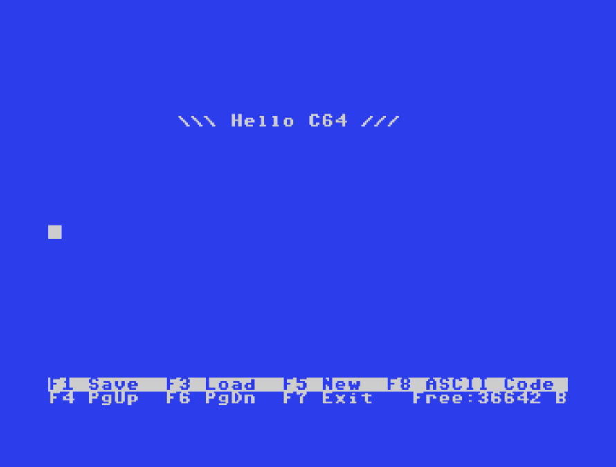
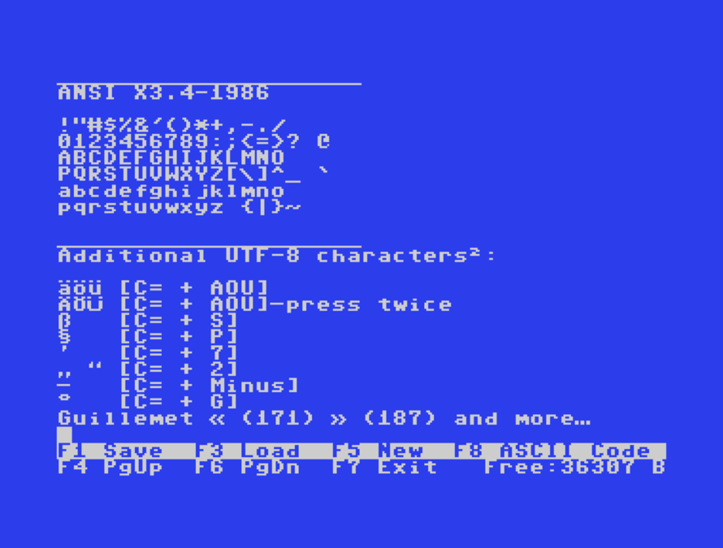

# C64 ASCII Text Editor V2
A text editor capable of loading, editing, and saving ASCII text.  
  
<p>

  
</p>  
<p>

  
</p>  

You can open and edit text files that you’ve transferred to the C64 from Windows or Linux. After editing them on the C64, you can process the text file on your PC again—it remains compatible.  
The editor supports the 7-bit ASCII character set (ANSI X3.4-1986), with the exception of the NUL and CR characters, which are deliberately ignored when loading a file.  
Special characters are mapped to suitable C64 screen codes for display.  
  
### Features
  
- Files are saved as C64 SEQ files containing plain ASCII text  
  (On Windows, the file extension must be changed to `.txt`)  
- Line ending LF or CRLF selectable in the source code  
- Text buffer at `$36B7-$CEFF` (36,681 bytes); BASIC ROM is switched off  
- Upper/lower case character set is copied to RAM at $D000  
- Application memory usage: approx. 15 KByte  
- Every input is converted to ASCII  
- Characters not available on the keyboard can be entered manually with F8  
- Custom characters for German umlauts in UTF‑8 are available  
- Files too large for memory can be loaded in parts (e.g. to read a whole book)  
- Before saving to disk, the free space is checked  
- Supported file access via the UCI interface (Ultimate 64, C64 Ultimate)  
- UCI: Files too large for memory are loaded automatically in chunks as you scroll  
- Disk images and programs (e.g. .d64, .prg) are not loaded or saved in the editor (optional)  
   
### ANSI X3.4-1986 Characters  
```
!"#$%&'()*+,-./ 
0123456789:;<=>? @  
ABCDEFGHIJKLMNO  
PQRSTUVWXYZ[\]^_ `  
abcdefghijklmno   
pqrstuvwxyz {|}~   
```  
  
### Keyboard Controls  
    F1 = Save   F3 = Load   F5 = New   F8 = Code input   F7 = Exit  
      
    Cursor keys  =  Move pointer 
    HOME    =   Start of line
    HOME 2x =   Start of text/file
    CLR     =   End of text/file 
    F2      =   Display control characters on/off 
    F4 / F6 =   Page up / down   
  
    DEL          =  Backspace          
    SHIFT+DEL    =  Delete (INST)     
    RETURN       =  New line           
    CTRL+I       =  Tabulator  
  
    Direct character input on the C64 keyboard:  
        Pound              = Backslash \  
        SHIFT+Pound        = Underscope _ 
        Left Arrow         = Backtick `
        SHIFT+Plus         = Curly Brace {
        SHIFT+Minus        = Curly Brace }
        | (Up Arrow)       = ASCII character Pipe (|)         
        SHIFT+| (Up Arrow) = Caret ^  
        SHIFT+:            = Square Bracket [  
        SHIFT+;            = Square Bracket ]  
        C= + A / O / U     =  Umlaut ä ö ü (again at once: Ä/Ö/Ü)
        C= + S             =  ß
        C= + P             =  Section sign §
        C= + G             =  Degree °
        C= + Minus         =  Dash –
        C= + 2             =  Quotes „ “ low at the start otherwise high
        C= + 7             =  Apostrophe ’
  
    F8 = Enter any ASCII code (decimal) 
         33–126 = printable ASCII characters   
         0–31 = control characters, 32 = SPACE, 127 = DEL
         (Inputs of 0 and 13 are ignored)  
  
         Examples of decimal values:  
         126 = ~  123 = {  125 = }  9 = Tab   
  
         Examples of Unicode values:  
         223 = ß  8218 = ‚  8216 = ‘  8230 = …  
         
  
### Starting
Start the program from floppy disk using `LOAD"TEXTEDITOR",8,1` and `RUN`.
  
### File Browser, Drive Selection, Loading and Saving
<p>


</p>
When loading (F3) or saving (F1), a file browser is displayed. You can select floppy drives 8–11. On Ultimate devices, drive U is also available, providing direct access to USB sticks and SD cards through UCI file access.

Use the CRSR Up/Down keys to navigate. Press RETURN to open a directory, or select '..' to go back. In LOAD mode, press RETURN on a filename to load it. In SAVE mode, press RETURN to copy the filename to the input line. You can then edit the filename and press RETURN again to save. A confirmation prompt helps prevent accidental overwrites.
The wildcards '*' and '?' can be used when selecting files, but not when saving. You can optionally enter '$' to re-read the drive contents. Filenames can be up to 25 characters long for UCI and 16 characters for floppy disks. UCI access is case-sensitive.  
  
### Exiting
To exit the editor, press F7 then confirm by pressing Y.  
  
### Quick Note
The line ending (LF/CRLF), the file extensions in the blocklist, translated characters, colours, and text outputs, can all be easily changed in the source code. You’ll find them as options near the top, below the descriptions.  
  
    
<br>  
<br>  
     
> [!Important]
>**AI Notice:**  
>The code was created with the assistance of Claude.  
   
### Useful Information
PETSCII Codes
```  
https://www.c64-wiki.de/wiki/PETSCII  
```  
ASCII Encodes 
```  
https://en.wikipedia.org/wiki/ASCII  
```  
  
   
